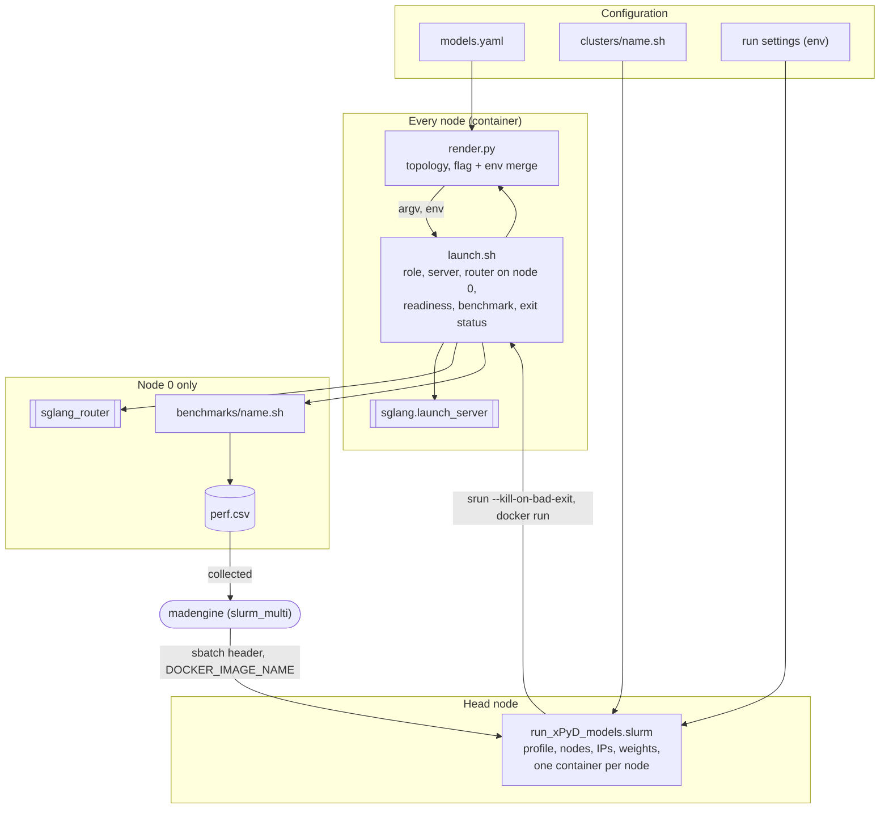

# sglang_disagg: architecture and onboarding

How the SGLang disaggregated prefill/decode recipe is put together, what moved
where in the rewrite, and how to onboard a new model. For the list of settings
and quick-start commands, see [README.MD](README.MD).

## Why the recipe is layered

The previous recipe kept everything in two shell scripts. Supported models were
listed in four places, server flags were concatenated strings run through
`eval`, cluster paths and NICs were hard-coded, and the same server command was
built three times with small differences. Adding a model meant editing shell
code; moving to another cluster meant editing paths in several files; a new
SGLang release broke it with no warning until a job had been allocated.

The rewrite gives each kind of fact one home, owned by whoever knows it. The
split mirrors madengine's own configuration scopes (see madengine's
`docs/distributed-config.md`), so the recipe and madengine agree on what lives
where.

| Layer | File | Decided by | Examples |
|-------|------|------------|----------|
| Model | `models.yaml` | whoever tuned the model | `--mem-fraction-static`, CUDA-graph batch sizes, wide-EP flags |
| KV transport | `models.yaml`, `backends:` section | whoever validated the backend | `--disaggregation-transfer-backend mori`, which modes it supports |
| Site | `clusters/<name>.sh` | whoever runs the cluster | model roots, log root, mounts, NIC lists, GID index |
| Measurement | `benchmarks/<name>.sh` | whoever defines the benchmark | concurrency sweep, agentic replay |
| Run | environment variables | whoever launches the job | `MODEL_NAME`, `xP`, `yD`, `PARALLEL_MODE`, `EXTRA_*_ARGS` |
| Cards | `matrix.yaml` -> `models.json` | whoever curates the madengine suite | which model x backend x mode combinations exist |

Everything else is generic code that does not change when a model, cluster or
benchmark is added: `render.py`, `launch.sh`, `run_xPyD_models.slurm` and
`settings.sh`. Every default lives in `settings.sh`; `render.py` reads its
settings through it, so the shell scripts and the renderer cannot disagree.

## Components



| File | Role |
|------|------|
| `run_xPyD_models.slurm` | Host driver; only places containers. Loads the cluster profile, picks the nodes and resolves their addresses, finds `<root>/<MODEL_NAME>` on every node, and starts one container per node with `srun --kill-on-bad-exit=1`. Needs no Python packages on the host. |
| `launch.sh` | Container entrypoint, one per node. Gets this node's role, environment and command from `render.py` (which validates the settings), starts the server; node 0 also writes `plan.txt`, starts the router, waits for a real completion, runs the smoke test and the benchmark. |
| `render.py` | The only place that knows the topology and the flag and environment rules. Commands: `plan`, `validate`, `node`, `env`, `argv`, `router-argv`, `models`, `check`. |
| `settings.sh` | Every default, the mapping from older setting names, and cluster-profile loading. Sourced on the host and in the container, and run by `render.py`. |

## How flags are resolved

`render.py` builds one flag map and one environment per role. Each layer can
set, replace or remove a single flag or variable; nothing is string-concatenated.

1. `defaults` in `models.yaml`, resolved as `base` -> `modes.<mode>` -> `roles.<role>` -> `roles.<role>.<mode>`
2. the model's entry, resolved the same way (so any model setting beats any default)
3. the KV backend's `args` from the `backends:` section
4. `overlays` from `models.yaml` (`radix_cache`, `server_metrics`; both on for the agentic benchmark)
5. `EXTRA_SERVER_ARGS`, then `EXTRA_PREFILL_ARGS` / `EXTRA_DECODE_ARGS`, appended last

Values: `true` is a bare flag, `false` or `null` removes the flag, a list gives
several values, and `"A..B"` expands to the integers A to B. An entry can start
from another with `extends:`; under `extends`, `null` drops the inherited value
(DeepSeek-R1 uses this to keep the default memory fraction that DeepSeek-V3
overrides).

The launcher owns topology and transport flags (`--model-path`,
`--disaggregation-mode`, `--host`, `--port`, `--tp-size`, `--dp-size`,
`--ep-size`, `--nnodes`, `--node-rank`, `--dist-init-addr`,
`--disaggregation-ib-device`). `render.py` rejects them in the catalog, along
with keys that are neither a `--flag` nor a known mode, so a typo such as
`wide-ep:` fails at validation instead of being silently ignored.

**Environment** layers the same way: `env:` maps can sit at the top of an entry
or in any mode, role or role x mode block, and `null` removes a variable. The
MoRI expert-parallel tuning, for example, is `defaults.modes.wide_ep.env` plus
`defaults.roles.decode.wide_ep.env`. Anything already in the environment (a
run setting, or the cluster profile's fabric tuning) wins over the catalog.
`launch.sh` adds only what must be computed on the node: the control-plane
interface (`GLOO_SOCKET_IFNAME` and friends) from the default route.

`render.py check`, run inside an image, confirms that every flag the catalog can
produce exists in that image's SGLang, and that every `SGLANG_*` variable is
read somewhere in its source. On v0.5.22 every flag is valid, but it reports
`SGLANG_MORI_FP8_DISP`, `SGLANG_MORI_FP4_DISP` and `SGLANG_MORI_FP8_COMB`:
v0.5.22 replaced them with `SGLANG_MORI_DISPATCH_DTYPE` / `SGLANG_MORI_COMBINE_DTYPE`.
Putting back the pre-v0.5.2x `--cuda-graph-bs` is reported for all 18
combinations that use it.

The rendered command is passed as an argument list (no `eval`) and written at
the top of each server log and in `plan.txt`. SGLang's `--config` file was
considered and not used: its loader rejects some argparse action types, and a
command line works on every version.

## Topology

The node count decides where the router runs: with xP + yD nodes it shares node
0 with the first prefill server; with xP + yD + 1 (`DEDICATED_ROUTER=1`) it has
node 0 to itself.

Within each role, the nodes are split into servers of (TP x DP) / GPUs-per-node
nodes each:

| Mode | Per-server size | Result |
|------|-----------------|--------|
| `tp` | `PREFILL_TP_SIZE` / `DECODE_TP_SIZE`, default one node | xP prefill servers and yD decode servers; TP 16 on 8-GPU nodes gives two-node servers |
| `wide_ep` | all the role's nodes, TP = DP = EP = nodes x GPUs | one prefill server across xP nodes, one decode server across yD nodes |

Each server's first node is its leader; multi-node servers get `--nnodes`,
`--node-rank` and `--dist-init-addr <leader>:5757`. The router registers each
server's leader. Wide-EP servers also get `--dp-size` and `--ep-size`.

Preview any layout without a job:

```bash
MODEL_NAME=DeepSeek-V3 PARALLEL_MODE=wide_ep xP=2 yD=2 python3 render.py plan
```

## Run lifecycle

```mermaid
sequenceDiagram
    participant H as run_xPyD_models.slurm (head node)
    participant P as node 0: prefill + router
    participant D as node 1..n: servers
    H->>H: profile, nodes, IPs, weights
    H->>P: srun --kill-on-bad-exit, docker run launch.sh
    H->>D: (same step)
    P->>P: render.py: validate, role, env, command; plan.txt
    D->>D: render.py: validate, role, env, command
    P->>P: start server, start router (waits for workers itself)
    D->>D: start server
    loop until a completion succeeds
        P->>P: POST /v1/completions through the router
    end
    P->>P: smoke test, benchmarks/name.sh, perf.csv
    P-->>H: exit status of the benchmark
    D->>D: router gone for 30s: stop server, exit 0
    H->>H: docker rm
```

- **No start-up barrier.** Multi-node servers rendezvous through PyTorch
  distributed; the router waits for its workers (`--worker-startup-timeout-secs`).
  Readiness is a real completion through prefill, KV transfer and decode, so it
  does not depend on log files or a shared filesystem.
- **Failures end the job.** A node whose server exits prints the last 40 lines
  of its log and exits 1; `srun --kill-on-bad-exit` then stops every node. A
  broken setting (every container validates before starting anything), an
  unhealthy GPU or missing weights end a job in seconds to a minute instead of
  holding the allocation until the time limit.
- **Teardown.** Non-router nodes stop once node 0's router has been unreachable
  for 30 seconds, and exit 0. The job's exit status is node 0's benchmark status.
- **Logs.** `$LOG_ROOT/$SLURM_JOB_ID/`: `plan.txt`, `launch_NODE<N>.log`,
  `prefill_NODE<N>.log`, `decode_NODE<N>.log`, `proxy_NODE0.log`, benchmark
  `.log`/`.csv`/`.jsonl`, `perf.csv`.

## madengine integration

Cards are generated from `matrix.yaml` by `gen_models_json.py`, which validates
each one against the catalog. A card carries the model and run shape, never site
facts or flags:

```json
{
  "name": "pyt_sglang_disagg_mori_io_llama-3.1-8b",
  "scripts": "run_xPyD_models.slurm",
  "args": "",
  "distributed": {"launcher": "slurm_multi", "nnodes": 2},
  "env_vars": {"MODEL_NAME": "Llama-3.1-8B-Instruct", "xP": "1", "yD": "1",
               "KV_TRANSFER_BACKEND": "mori", "PARALLEL_MODE": "tp", "...": "..."}
}
```

- madengine sizes the allocation from `distributed.nnodes` and writes the
  `#SBATCH` header itself (partition, time, exclusivity, nodelist); the script's
  own `#SBATCH` lines only apply to a plain `sbatch`.
- madengine builds and pushes the image, pulls it on every node and exports
  `DOCKER_IMAGE_NAME`. It also exports `IPADDRS`, but the script always resolves
  the addresses itself (preferring `FABRIC_SUBNET`): madengine's lookup returned
  one address for two nodes in testing.
- `args` must be present (madengine reads it unconditionally) and stays empty:
  madengine passes it to the script, not to `sbatch`.
- Results: `perf.csv` is written to `$LOG_ROOT/$SLURM_JOB_ID/`, which on
  `oci-m2m` is the location madengine searches.
- `launch.sh` also accepts madengine's built-in sglang-disagg launcher names
  (`SGLANG_NODE_RANK`, `SGLANG_NODE_IPS`, `SGLANG_DISAGG_PREFILL_NODES`,
  `SGLANG_DISAGG_DECODE_NODES`), so it can serve as that launcher's container
  entrypoint as well.

## Onboarding a new model

Worked example: **Qwen3-30B-A3B** (`Qwen3MoeForCausalLM`, 128 experts, 8 active),
whose weights are already at `/shared_inference/models_blog/Qwen3-30B-A3B`. The
outputs below are from running these steps; long lines are trimmed.

### 1. Put the weights where every node can see them

Under one of the cluster profile's `MODEL_ROOTS` as `<root>/<MODEL_NAME>`, or
set `MODEL_PATH` at run time. The host driver checks every node and reports per
node which candidate paths are missing.

### 2. Add an entry to `models.yaml`

Until then the model is rejected with the list of known models:

```
$ MODEL_NAME=Qwen3-30B-A3B python3 render.py validate
render.py: error: unknown MODEL_NAME 'Qwen3-30B-A3B'; models.yaml has: Llama-3.1-8B-Instruct, Qwen3-32B, ...
```

Start with an empty entry; the shared defaults apply:

```yaml
models:
  Qwen3-30B-A3B: {}
```

### 3. Preview the commands

```
$ MODEL_NAME=Qwen3-30B-A3B python3 render.py plan
model=Qwen3-30B-A3B mode=tp backend=mori xP=1 yD=1 nodes=2 (router on node 0) overlays=-

[node 0] node0  prefill server 0 node 1/1 tp=8 + router
  python3 -m sglang.launch_server --model-path ... --disaggregation-mode prefill ... --tp-size 8
    --attention-backend aiter --watchdog-timeout 1000000 --mem-fraction-static 0.73 --trust-remote-code
    --decode-log-interval 1 --log-level-http warning --load-balance-method round_robin
    --disable-cuda-graph --disaggregation-transfer-backend mori
  python3 -m sglang_router.launch_router --pd-disaggregation --prefill http://node0:3000 --decode http://node1:3000 ...

[node 1] node1  decode server 0 node 1/1 tp=8
  python3 -m sglang.launch_server ... --disaggregation-mode decode ... --disable-radix-cache
    --cuda-graph-bs-decode 1 2 3 ... 512 --disaggregation-transfer-backend mori
```

### 4. Check the flags against the image you will run

```bash
docker run --rm -v $PWD:/r -w /r --entrypoint python3 <image> render.py check
```

### 5. Run it

A quick first run keeps the sweep short; the full defaults come later:

```bash
export DOCKER_IMAGE_NAME=<image> MODEL_NAME=Qwen3-30B-A3B xP=1 yD=1
BENCHMARK_COMBINATIONS=1024/1024 BENCHMARK_CONCURRENCY="8 64" \
  sbatch -N 2 -p <partition> run_xPyD_models.slurm
```

`BENCHMARK_SCRIPT=none` stops after the smoke test, for checking that the model
serves at all.

### 6. Tune, then record the result in the catalog

Try flags at run time without editing anything; they are appended last and win:

```bash
EXTRA_DECODE_ARGS="--mem-fraction-static 0.80 --cuda-graph-bs-decode 1 2 4 8 16 32 64 128" sbatch ...
```

Once a setting is validated, move it into the entry so every run gets it:

```yaml
  Qwen3-30B-A3B:
    roles:
      decode:
        tp:
          --mem-fraction-static: 0.80
```

### 7. Optional: enable wide expert parallelism

`PARALLEL_MODE=wide_ep` is refused until the entry declares the mode:

```
$ MODEL_NAME=Qwen3-30B-A3B PARALLEL_MODE=wide_ep python3 render.py validate
render.py: error: Qwen3-30B-A3B does not support PARALLEL_MODE=wide_ep (supported: tp); add a modes.wide_ep block to its models.yaml entry to enable it
```

Add the mode's flags (DeepSeek-V3's entry is a working reference; these values
for Qwen3 are illustrative and need a run to validate):

```yaml
  Qwen3-30B-A3B:
    modes:
      wide_ep:
        --moe-a2a-backend: mori
        --enable-dp-attention: true
        --max-running-requests: 8192
    roles:
      decode:
        wide_ep:
          --cuda-graph-bs-decode: [1, 2, 4, 8, 16, 32, 64, 128]
```

The plan then shows TP = DP = EP = 8 per node, `--load-balance-method
follow_bootstrap_room` and the MoRI tuning environment from the defaults, and
the flags above. A model whose quirks are environment variables rather than
flags puts them in an `env:` block, at the top of its entry or in the mode or
role they apply to (for example `modes.wide_ep.env.SGLANG_MORI_FP8_DISP: "False"`
for an MXFP4 checkpoint).

### 8. Add madengine cards

In `matrix.yaml`, add a slug and list the model in the groups it should run in
(append it, to keep the `models.json` diff small):

```yaml
slugs:
  Qwen3-30B-A3B: qwen3-30b-a3b
groups:
  - variant: mori_io
    models: [..., Qwen3-30B-A3B]
  - variant: mori_dp
    models: [DeepSeek-V3, DeepSeek-R1, Qwen3-30B-A3B]
```

Regenerate and test:

```
$ python3 gen_models_json.py
wrote 20 cards to .../models.json        # adds pyt_sglang_disagg_mori_io_qwen3-30b-a3b, pyt_sglang_disagg_mori_dp_qwen3-30b-a3b
$ python3 tests/test_render.py
OK
```

`gen_models_json.py` refuses a card whose model, mode or backend the catalog does
not support, and the test suite fails if `models.json` is out of date.

### 9. Run the card through madengine

```bash
madengine run --tags pyt_sglang_disagg_mori_io_qwen3-30b-a3b \
  --additional-context '{"slurm": {"partition": "<partition>"}}'
```

No shell code is edited at any step.

## Other extension points

- **A cluster:** add `clusters/<name>.sh` with a `# hosts:` glob (used by
  `CLUSTER=auto`) and the site's values; `settings.sh` lists each setting and
  its default, and `clusters/oci-m2m.sh` is a worked example.
- **A benchmark:** add `benchmarks/<name>.sh`. It runs on node 0 once the router
  serves completions, with `ROUTER_HOST`, `ROUTER_PORT`, `METRICS_ENDPOINTS`,
  `MODEL_PATH`, `MODEL_NAME` and `RUN_DIR` set, and writes its results and
  `perf.csv` to `RUN_DIR`. Select it with `BENCHMARK_SCRIPT=<name>`. A benchmark
  that wants other names maps them itself, as `benchmarks/agentic.sh` does.
- **A KV backend:** add an entry under `backends:` in `models.yaml` with its
  `args` and the `modes` it has been validated with.
- **A new SGLang release:** change `BASE_DOCKER` in the Dockerfile and run
  `render.py check` in the new image; it reports flags the release rejects and
  `SGLANG_*` variables it no longer reads.

## What changed from the previous recipe

Relative to `develop` at `826f087`.

### Added

| File | Lines | Purpose |
|------|------:|---------|
| `render.py` | 579 | Catalog merge (flags and environment), topology, per-node commands, `plan` / `check` |
| `launch.sh` | 199 | Container entrypoint (replaces `sglang_disagg_mori_io_ep.sh`) |
| `settings.sh` | 96 | Every default, legacy-name mapping, cluster-profile loading |
| `clusters/oci-m2m.sh` | 47 | This cluster's paths, NICs, subnet, RoCE and NCCL tuning |
| `benchmarks/sweep.sh` | 57 | Concurrency sweep (replaces `benchmark_xPyD.sh`) |
| `benchmarks/agentic.sh` | 7 | Agentic replay hook (replaces `benchmark_agentic.sh`) |
| `matrix.yaml` | 66 | Source of the madengine cards |
| `gen_models_json.py` | 77 | Writes and checks `models.json` |
| `tests/test_render.py` | 209 | Offline tests: merge rules, environment, settings and profiles, topology, cards |
| `ARCHITECTURE.md` | | This document |

### Changed

| File | Change |
|------|--------|
| `run_xPyD_models.slurm` | Rewritten (488 -> 145 lines): profile-driven paths, one-step address resolution, per-node weight check, environment forwarded by name only, `--kill-on-bad-exit`, cleans up only its own containers; no Python needed on the host |
| `models.yaml` | New schema (`base` / `modes` / `roles` flag maps with `env:` at any level, `extends`, plus `backends` and `overlays` sections); same flags as before, and the MoRI tuning environment |
| `models.json` | Generated; same 18 card names, order and tags. Settings use `PARALLEL_MODE` / `KV_TRANSFER_BACKEND`; node count in `distributed.nnodes`; `args` empty |
| `parse_to_csv.py` | Accepts the prompt count on `RUNNING:` lines; no longer drops the first point; attributes results correctly after a failed run; tags from the run's settings, GPU architecture from `rocminfo` |
| `README.MD` | Rewritten for the new layout; includes the `parse_to_csv.py` usage |
| `docker/sglang_disagg_inference.ubuntu.amd.Dockerfile` | `BASE_DOCKER` defaults to `lmsysorg/sglang:v0.5.22-rocm10-mi30x`; `INSTALL_MORI` defaults to 0 (the base ships a matching MoRI) |
| `scripts/common/agentx/tests/run_offline.sh`, `resolve_ctx_offline.sh`, `agentx/README.md`, `agentx/templates/README.md` | Point at `benchmarks/agentic.sh`; static check updated for the new `AGENTIC_CONFIG` expansion |

### Removed

| File | Lines | Why |
|------|------:|-----|
| `sglang_disagg_mori_io_ep.sh` | 762 | Replaced by `launch.sh` + `render.py` |
| `sglang_disagg_server.sh`, `set_env_vars.sh` | 307 | Old Mooncake launcher; nothing called it |
| `mori_ep_env.sh` | 124 | MoRI tuning moved to `env:` blocks in `models.yaml`, NIC and NCCL tuning to the cluster profile; variables nothing reads dropped |
| `benchmark_xPyD.sh`, `benchmark_agentic.sh` | 73 | Moved to `benchmarks/` |
| `benchmark_xPyD_GSP.sh` | 69 | Unselectable, wrong port and log path |
| `benchmark_parser.py` | 216 | Unused; `parse_to_csv.py` is the parser |
| `salloc_launch.sh` | 32 | Referenced models the allowlist rejected |
| `socket_barrier.py`, `socket_wait.py` | 96 | Replaced by SGLang/router readiness and Slurm |
| `HowToParseData.md` | 120 | `parse_to_csv.py` usage, now a few lines in the README |

### Behaviour changes

- **Equivalence.** For all 7 models x modes x backends at 1P1D and 2P2D, with
  the agentic overlay on and off (192 node commands), the rendered server
  commands match the previous launcher except for three intended changes:
  `--prefill-round-robin-balance` is gone (a no-op since v0.5.12 and rejected by
  v0.5.22), `--cuda-graph-bs` is now `--cuda-graph-bs-decode` (the old flag is
  ambiguous in v0.5.22), and node 0's prefill server now gets the metrics flags
  in agentic runs (previously omitted).
- **Environment.** Compared for every mode and role against the previous
  recipe on `oci-m2m`, the servers see the same variables except: NCCL's debug
  output (`NCCL_DEBUG`, `NCCL_DEBUG_SUBSYS`, `NCCL_TOPO_DUMP_FILE`) is off by
  default; `GLOO_TIMEOUT_MS`, `TORCH_DIST_INIT_BARRIER_TIMEOUT`,
  `MORI_QPS_PER_CONNECTION`, `SGLANG_ROUTER_STDOUT_LOGS` and
  `MORI_MAX_DISPATCH_TOKENS_DECODE` are gone (nothing in either image reads them);
  `SGLANG_USE_AITER` is left to the image, which sets it; and
  `SGLANG_MORI_FP8_DISP` is set only in wide-EP mode, the only path that reads it.
- **Validation** happens in the containers, so the host needs no Python packages;
  `plan.txt` is written by node 0.
- **Defaults.** Without `RUN_MORI` / `KV_TRANSFER_BACKEND`, the backend is MoRI
  (the old Slurm script fell back to Mooncake, contrary to its README). On
  `oci-m2m`, KV transfer uses the `mlx5_1` management NIC unless
  `USE_CX7_NICS=1`; the cards already did. The cards set both explicitly.
- **Sweep.** `BENCHMARK_ITR` now repeats (it ran once regardless); its default
  is 1. The 60-second sleeps are gone. `bench_serving` is called with full flag
  names and writes its per-run JSON to the log directory, not the recipe
  directory.
- **Results.** `perf.csv` tags MoRI tensor-parallel runs `mori_io` (they were
  tagged `mooncake`) and records the detected GPU architecture.
- **Logs.** The Slurm output file is the default `slurm-<job>.out` in the
  submit directory; per-job logs go to the profile's `LOG_ROOT`.
- **Older names** (`DP_MODE`, `RUN_MORI`, `SKIP_BENCHMARK`, `LOG_PATH`,
  `USE_CX7_NICS`) keep working through `settings.sh`.

## Validation

- Offline: `tests/test_render.py` (18 tests), the old-versus-new command and
  environment comparisons above, `gen_models_json.py --check`, ShellCheck at
  warning level, and the shared agentic offline suites (`run_offline.sh`,
  `resolve_ctx_offline.sh`).
- `render.py check`: in `lmsysorg/sglang:v0.5.22-rocm10-mi30x` every flag exists
  and the three renamed MoRI variables are reported; in the September CI image
  (SGLang 0.5.12.post1, with the older `--cuda-graph-bs` name) everything passes.
- Live, Llama-3.1-8B-Instruct, 1P1D, tensor parallel, MoRI, MI300X, same two
  nodes as a run of the previous recipe:

  | Path | Result | Total tok/s at concurrency 8 / 64 / 512 |
  |------|--------|------------------------------------------|
  | Previous recipe | passed | 5,580 / 31,200 / 41,010 |
  | New recipe, plain `sbatch` | passed, 11 min 55 s, serving after 323 s | 5,601 / 30,367 / 40,399 |
  | New recipe, madengine `slurm_multi` | passed, 7 results collected | 5,584 / 30,663 / 39,693 |

## Known gaps

- Not yet run live: Mooncake, the agentic benchmark, xP or yD above 1, the
  dedicated-router layout.
- SGLang v0.5.22 reads `SGLANG_MORI_DISPATCH_DTYPE` / `SGLANG_MORI_COMBINE_DTYPE`
  (default `auto`) instead of `SGLANG_MORI_FP8_DISP`, `SGLANG_MORI_FP4_DISP` and
  `SGLANG_MORI_FP8_COMB`, so the catalog's MoRI dispatch settings only take effect
  on older images. The catalog keeps the older names until the base image is chosen.
- SGLang v0.5.22 compiles its Rust radix-tree extension (from crates.io) each
  time a decode server starts; building it into the image would save minutes per
  run and the network dependency.
- One cold DeepSeek-V3 start on v0.5.22 spent 34 minutes copying expert weights
  to the GPUs, with the loader threads serialized on a HIP runtime lock; the next
  start on the same nodes loaded in 38 seconds. Not yet understood.
- madengine: its node-IP discovery can return fewer addresses than nodes, it
  requires the `args` key, and its fallback search for `perf.csv` is specific to
  `/shared_inference`.
