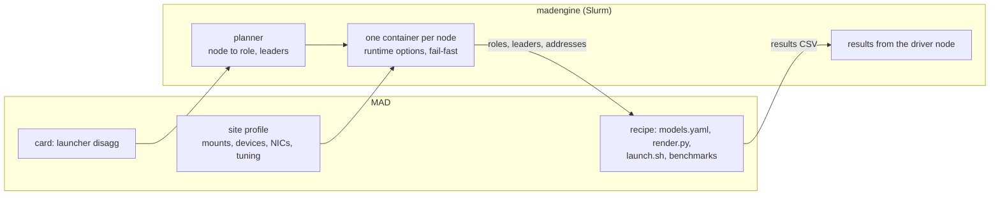

# Design: role-aware Slurm jobs in madengine

| | |
|---|---|
| **Status** | Draft for discussion |
| **Date** | November 3, 2026 |
| **Scope** | madengine's Slurm deployment; the MAD recipes that use `slurm_multi` (`sglang_disagg`, `vllm_dissag`, `large-ep-benchmark`) |
| **Builds on** | *Proposal: a generic, config-driven SGLang disaggregated recipe* (October 29), and `scripts/sglang_disagg/ARCHITECTURE.md` on [vdar25/MAD, branch `sglang-cleanup`](https://github.com/vdar25/MAD/tree/sglang-cleanup) |
| **Out of scope** | Kubernetes (section 7 notes how it would follow) |

## Summary

Every card in MAD that declares a distributed launcher (39 of them) uses
`slurm_multi`, madengine's documented escape hatch, instead of a real launcher. Each of the three recipes behind
them ships its own host script to start containers, and its own copy of the
cluster's paths and network settings.

Two gaps in madengine cause this. Its containers cannot take extra devices or
options, and its job model cannot express nodes with different roles. This
document proposes closing both on Slurm with four additions:

1. **Container options from the site profile**, using the `runtime` block madengine's configuration already defines but does not apply.
2. **Node groups**: a card declares roles such as prefill, decode and router, and madengine assigns nodes to them. A `disagg` preset writes the groups for the common cases.
3. **A per-node contract**: the same variables in every container, giving each node its roles, its server's leader and the leaders of every other group.
4. **Driver lifecycle**: any node failing ends the job; when the driver role finishes, the other roles are stopped and the job takes its exit status.

The rule behind all four: **madengine owns where things run; the recipe owns what
runs.** The changes are additive. No existing launcher changes, and `slurm_multi`
stays for workloads that must act on the host itself.

The result: the 34 disaggregated cards and the 5 `large-ep-benchmark` cards run
on madengine's normal path. The three host scripts (145, 702 and 126 lines) are
deleted, and each cluster is described once for every workload.

## 1. How this connects to the recipe proposal

The recipe proposal rests on two principles: every setting has one home, owned
by whoever knows it, and generic code is written once. It applied them inside the
SGLang recipe. Across recipes, two kinds of facts are still copied:

| Repeated fact | `sglang_disagg` (after the cleanup) | `vllm_dissag` | `large-ep-benchmark` |
|---|---|---|---|
| Host script that resolves node addresses, starts one RDMA-capable container per node and cleans up | `run_xPyD_models.slurm`, 145 lines | `run_xPyD_models.slurm`, 702 lines | `run_benchmark.sbatch`, 126 lines |
| Cluster facts: weight and log paths, mounts, NICs | `clusters/oci-m2m.sh` | Written into the script (`/shared_inference/...`, `/mnt/m2m_nobackup/...`) | Written into the script, plus `IBDEVICES=mlx5_0` in the cards |

These copies already disagree. On the same cluster, `large-ep-benchmark` uses
`mlx5_0` while the SGLang profile uses `mlx5_1`, and nothing reconciles them.

The cleanup is what makes this design cheap. It already split the SGLang recipe
into a host script that only places containers and a container entrypoint
(`launch.sh`) that serves. This design moves that boundary from inside the recipe
to between the recipe and madengine:

| Concern | After the cleanup | After this design |
|---|---|---|
| Nodes, addresses, one container per node, devices and mounts, failure handling | `run_xPyD_models.slurm`, one per recipe | madengine's Slurm job template, shared by every workload |
| Cluster facts | `clusters/oci-m2m.sh`, one per recipe | One site profile per cluster, shared by every workload |
| Which node is prefill, decode or router; each server's leader node | `render.py` (`build_topology`) | madengine's planner, from the card's groups. `render.py` checks the plan. |
| How many nodes each server spans | `render.py`, from the parallel mode | Written into the card by `gen_models_json.py`, from the catalog |
| Commands, flags, environment | `render.py`, `models.yaml` | Unchanged |
| Readiness, router, benchmark | `launch.sh` | Unchanged; its teardown loop is replaced by the driver rule |
| Results | `perf.csv`, found by madengine's path search | Collected from the driver node |
| Cards | `launcher: slurm_multi` | `launcher: disagg` |



## 2. Problems

### 2.1 Why workloads use `slurm_multi`

| Workload | Cards | What madengine cannot express |
|---|---|---|
| `sglang_disagg` | 18 | Nodes with different roles, and one server spanning several nodes |
| `vllm_dissag` | 16 | The same |
| `large-ep-benchmark` | 5 | Only container options (`/dev/infiniband`, `--privileged`, RDMA mounts). Otherwise it is an ordinary multi-node `torchrun` job. |

### 2.2 What in madengine blocks the normal path

- **Container options are fixed.** The container runner builds one docker
  option string from the GPU vendor. Hydra profiles can carry a `runtime`
  block (`devices`, `capabilities`, `security_opts`, `network_mode`, `ipc`), but
  the translator stores it as metadata and nothing applies it. Mounts can be
  added through `docker_mounts`. Devices, `--privileged`, ulimits and shared
  memory size cannot.
- **The job model is homogeneous.** Every node runs the same script. Launchers
  are a closed list (`VALID_LAUNCHERS`), each with its own code generator, and
  about 35 places in 8 files branch on the launcher's name. The `sglang-disagg`
  launcher exports node counts and addresses but no roles or leaders, so every
  recipe works those out itself.
- **There is no lifecycle beyond "every task exits".**
  - The job template's `srun` has no `--kill-on-bad-exit`, and this cluster's
    default is off (`KillOnBadExit=0`). A crashed decode server leaves the other
    nodes waiting until the time limit.
  - Rank 0 is assumed to be where results are.
  - Nothing describes roles that should stop once the benchmark is done.
- **Address discovery has no notion of the fabric.** It takes each host's
  first non-loopback DNS address. In testing, madengine's address list for a
  `slurm_multi` job held one address for two nodes, so the SGLang host script
  resolves addresses itself, preferring the cluster's subnet.
- **The multi-node Slurm preset assumes TCP.** It sets `NCCL_IB_DISABLE=1` and
  `NCCL_SOCKET_IFNAME=eth0`, which every RDMA workload has to override.

## 3. Design

### 3.1 Container options from the site profile

Make the existing `runtime` block take effect. The container's options are
merged in three layers, each able to add to the one before:

1. madengine's defaults for the GPU vendor (today's fixed string);
2. the site profile, for what the cluster's hardware needs;
3. the card, for what the workload needs (for example a larger shared-memory size).

The site profile is a YAML file that madengine's configuration loader merges
like any user-supplied file. It holds everything that is true of the cluster
until it is re-provisioned, the "site" scope in madengine's
`docs/distributed-config.md`:

```yaml
# sites/oci-m2m.yaml
hosts: "useocpm2m-*"            # lets a run pick the profile from the hostname
runtime:
  devices: [/dev/infiniband]
  options: [--privileged, --shm-size=64G, "--ulimit=nofile=1048576:1048576"]
docker_mounts:                  # container path: host path
  /shared_inference: /shared_inference
  /mnt/m2m_nobackup: /mnt/m2m_nobackup
fabric_subnet: "10.158."        # preferred node addresses
env_vars:
  MODEL_ROOTS: /mnt/m2m_nobackup/models_blog:/shared_inference/models_blog
  LOG_ROOT: /shared_inference/${oc.env:USER}/model_blog_logs
  KV_IB_DEVICES: mlx5_1
  NCCL_IB_HCA: mlx5_1
  NCCL_IB_GID_INDEX: "3"
  MORI_IB_GID_INDEX: "3"
  NCCL_IB_TC: "106"
  # ... the rest of clusters/oci-m2m.sh's RoCE and NCCL tuning
```

The SGLang profile's one piece of logic, `USE_CX7_NICS=1` switching to the
eight rail NICs, becomes a run-level override of `KV_IB_DEVICES` and
`NCCL_IB_HCA`, or a second profile.

### 3.2 Node groups

A card can declare groups. madengine places them and validates the arithmetic
when the job is submitted, before any nodes are allocated.

- A group has `instances` (default 1) and `nodes_per_instance` (default 1), and
  takes their product in nodes. An instance is one server; a two-node server
  has `nodes_per_instance: 2`.
- `colocate: <group>` puts a single-node, single-instance group on the first
  node of another group instead of a node of its own.
- Groups take nodes in declaration order from the allocation's node list. A
  node's rank is its position.
- The groups' node counts must add up to `distributed.nnodes`.
- At most one group is the `driver`. If none is marked, every node is a driver,
  which is how every existing launcher behaves.
- A card with no groups is one group of `nnodes` single-node instances, all
  drivers. Existing cards behave exactly as today.

Nobody writes groups by hand for the common case. The `disagg` preset expands to
them:

```json
"distributed": {
  "launcher": "disagg",
  "nnodes": 4,
  "disagg": {
    "prefill_nodes": 2, "prefill_nodes_per_server": 2,
    "decode_nodes": 2,  "decode_nodes_per_server": 2,
    "router": "colocated"
  }
}
```

That is DeepSeek-V3 with wide expert parallelism: one prefill server and one
decode server, each across two nodes. It expands to:

```json
"groups": [
  {"name": "prefill", "instances": 1, "nodes_per_instance": 2},
  {"name": "decode",  "instances": 1, "nodes_per_instance": 2},
  {"name": "router",  "colocate": "prefill", "driver": true}
]
```

and places as:

| Node | Roles | Instance | Position in instance |
|---|---|---|---|
| 0 | prefill, router (driver) | prefill 0 | 0 of 2 (leader) |
| 1 | prefill | prefill 0 | 1 of 2 |
| 2 | decode | decode 0 | 0 of 2 (leader) |
| 3 | decode | decode 0 | 1 of 2 |

With `"router": "dedicated"`, the router group is declared first and gets node 0
to itself, so `nnodes` is one higher. Tensor-parallel 1P1D is the same preset with
one node per role and one node per server. `sglang-disagg` becomes an alias of
`disagg` that keeps its current keys and its default 40/60 split when counts are
omitted.

The preset knows nothing about SGLang or vLLM. Both frameworks have prefill
servers, decode servers and a proxy in front of them.

### 3.3 The per-node contract

Every container gets the same variables. The names are proposals:

| Variable | Meaning | Node 1 in the example above |
|---|---|---|
| `MAD_NODE_RANK`, `MAD_NNODES` | This node's rank, and the node count | `1`, `4` |
| `MAD_NODE_ADDRS` | Every node's address, in rank order | the four nodes' addresses, comma-separated |
| `MAD_ROLES` | Roles on this node | `prefill` |
| `MAD_INSTANCE`, `MAD_INSTANCE_RANK`, `MAD_INSTANCE_NODES` | Which instance of its group, its position in it, and the instance's size | `0`, `1`, `2` |
| `MAD_INSTANCE_LEADER` | Address of the instance's first node, for `--dist-init-addr` | node 0's address |
| `MAD_<GROUP>_LEADERS` | Leader address of every instance in a group, e.g. what a router registers | `MAD_PREFILL_LEADERS`: node 0; `MAD_DECODE_LEADERS`: node 2 |
| `MAD_DRIVER` | `1` on driver nodes | `0` |
| `MAD_TOPOLOGY_FILE` | The full plan as JSON, mounted read-only | `/run/mad/topology.json` |

Today's exports (`MASTER_ADDR`, `NODE_RANK`, and the `SGLANG_*` names under the
`sglang-disagg` alias) stay, so existing scripts keep working.

**Addresses.** Before any container starts, one `srun` asks every node for its
own address. It prefers the site profile's `fabric_subnet`, then the source
address of the default route, which madengine already uses as a fallback. A node
without an address fails the job at that point, as madengine already does for
unresolved hosts.

### 3.4 Lifecycle

- **One `srun` step**, one task per node, with `--kill-on-bad-exit=1`. Any node
  exiting with an error stops every node.
- **The driver decides the result.** When the driver group exits, the other
  groups are stopped and the job takes the driver's exit status. There are two
  ways to stop the others, and the prototype should pick one:
  - `srun --wait=<seconds>`, which ends the remaining tasks a set time after the
    first task exits. This fits because a non-driver task exiting first is
    itself a failure.
  - The batch script cancels the step once the driver's completion marker
    appears. madengine already writes completion markers for `slurm_multi`.
- **Results come from the driver node**, not rank 0. The workload writes the
  results CSV that madengine already merges with its run metadata, so the search
  for a full-schema `perf.csv` on a shared filesystem is no longer needed.
- **Readiness stays in the workload.** Only the workload knows what "ready"
  means. For SGLang it is a completion through prefill, KV transfer and decode.

### 3.5 What stays out of madengine

The commands each role runs, model flags, the server environment, the router,
readiness checks and benchmarks stay in the recipe. These change with the
framework's release, which the recipe's Dockerfile pins, not with madengine's.
Moving the recipe from SGLang v0.5.12 to v0.5.22 alone meant that:

- one flag became ambiguous (`--cuda-graph-bs`) and another was rejected
  (`--prefill-round-robin-balance`);
- three MoRI settings were replaced by two new names.

madengine's Kubernetes `sglang-disagg` path writes the SGLang commands itself.
It starts `sglang.srt.disaggregation.mini_lb`, which no longer exists in v0.5.22,
so it cannot start a router on the current image. That is the failure mode this
boundary avoids.

## 4. How each change solves a problem

| Problem | Change | Result |
|---|---|---|
| Containers cannot get RDMA devices or options, so `large-ep-benchmark` uses `slurm_multi` | `runtime` options applied in layers: vendor defaults, site profile, card | `large-ep-benchmark` runs on the `torchrun` launcher; its host script is deleted |
| Nodes with different roles cannot be expressed | Node groups and the `disagg` preset | Disaggregated cards use madengine's normal path |
| Every recipe re-derives roles, leaders and addresses | One planner and one per-node contract | Recipes read their role and leaders; SGLang and vLLM share the preset |
| Host scripts copied per recipe (973 lines in total) | Placement in madengine's job template | The three host scripts are deleted |
| Cluster facts copied per recipe, already disagreeing | One site profile per cluster | A NIC or path changes in one file, for every workload |
| A crashed server holds the allocation until the time limit | `--kill-on-bad-exit` and the driver rule | Failures end the job in about a minute |
| Results assumed on rank 0, found by searching a cluster-specific path | Results collected from the driver node | Works on any cluster, with any router placement |
| Address lookup can return the wrong or too few addresses | Each node reports its address, preferring the fabric subnet | Correct address list, or an early failure that names the node |

## 5. What changes in MAD

### SGLang recipe

About 80% of the recipe from the proposal is unchanged: the catalog, command
rendering, the server, router and readiness logic in `launch.sh`, the
benchmarks, the parser and card generation.

| File | Change |
|---|---|
| `gen_models_json.py`, `models.json` | Cards use `launcher: disagg`, with nodes per server taken from the catalog's mode (`tp`: TP size divided by GPUs per node; `wide_ep`: all of the role's nodes) |
| `settings.sh` | Maps the `MAD_*` contract to the recipe's names, as it maps madengine's `SGLANG_*` names today |
| `render.py` | Reads roles and leaders from the contract. Keeps computing the expected layout for `render.py plan` previews, and checks madengine's plan against it at start-up. About 70 lines of placement become that check. |
| `launch.sh` | Takes its roles from `MAD_ROLES`; the 17-line "wait until the router is gone" teardown is removed |
| `clusters/oci-m2m.sh` | Becomes `sites/oci-m2m.yaml`, shared with the other recipes |
| `run_xPyD_models.slurm` | Deleted, or kept as a developer path (see section 8) |
| `parse_to_csv.py` | Writes the results CSV madengine merges with its run metadata |

### vLLM recipe

It adopts the same catalog, renderer and entrypoint pattern, on the same
`disagg` preset. Its 702-line host script is deleted rather than rewritten. This
replaces step 5 of the recipe proposal ("reuse the same host-side pieces in the
vLLM recipe"), because no host-side pieces remain.

### `large-ep-benchmark`

Its cards switch to the `torchrun` launcher. The docker options come from the
site profile, `run_ep_bench.sh` reads madengine's existing `torchrun` variables,
and its 126-line host script is deleted.

## 6. Plan

Each step can be reviewed and shipped on its own.

1. **Merge the SGLang recipe as proposed.** Nothing in the recipe proposal
   changes; it runs on `slurm_multi` today.
2. **madengine, additive (three pull requests):**
   1. Runtime options and site profiles. `large-ep-benchmark` moves first.
   2. `--kill-on-bad-exit` and the driver rule.
   3. Groups, the planner, the per-node contract, the `disagg` preset and the
      address preference.
3. **SGLang cards switch to `disagg`.** The host script is deleted and the site
   profile is shared.
4. **The vLLM recipe adopts the pattern.**

Later, outside this proposal:
- re-express the existing launchers as presets over the planner, which removes
  the per-launcher branches;
- the same planner producing Kubernetes Indexed Jobs and a headless service;
- Slurm heterogeneous jobs (supported by the cluster's Slurm 25.05), if groups
  ever need different resources, such as a CPU-only router.

## 7. Validation

- **Existing launchers unchanged.** For every existing launcher, the generated
  job script is byte-identical before and after when no groups or runtime
  options are set.
- **Planner tests.** Preset to groups to placement for tensor-parallel 1P1D and
  2P2D, wide-EP 2P2D, a dedicated router, and two-node tensor-parallel servers,
  plus the rejection cases (counts that do not add up, two drivers, colocating
  on a multi-node group).
- **Live, against numbers already measured with the new recipe:**
  - Llama-3.1-8B 1P1D, tensor parallel, MoRI: 39,693 tok/s at concurrency 512 through `slurm_multi`;
  - DeepSeek-V3 wide-EP 1P1D on the v0.5.12 image: 9,970 tok/s at concurrency 512 with plain `sbatch`;
  - `large-ep-benchmark` on two nodes.
- **Failure injection.** Killing a decode server ends the job within about a
  minute. A missing weights directory or a bad address fails before any server
  starts.

## 8. Risks and decisions

- **madengine is shared with training workloads.** The design is additive, and
  the byte-identical tests guard existing launchers. The later step of turning
  launchers into presets is where real risk sits, and it is outside this proposal.
- **Decision: the plain-`sbatch` path.** Today the SGLang recipe runs without
  madengine and needs no Python on the host. There are two options:
  - Keep `run_xPyD_models.slurm` as a developer path. It would duplicate
    madengine's placement, which is the drift this design removes.
  - Use `salloc` plus `madengine run` instead. madengine already runs in place
    inside an allocation, so the developer loop barely changes. The cost is
    needing madengine installed.

  Recommendation: the second option.
- **Decision: where site profiles live.** Recommendation: in MAD, next to the
  workloads, owned by whoever runs each cluster. Keeping them out of the
  madengine package means a NIC change doesn't wait for a madengine release, for
  the same reason framework flags stay in the recipes.
- **Open: how the driver stops the other roles** (`srun --wait` or the
  completion marker). Settled in the prototype for step 2.2.
- **Ordering.** The MAD changes in steps 3 and 4 need a madengine release with
  step 2. Until then the recipes keep running on `slurm_multi`.
